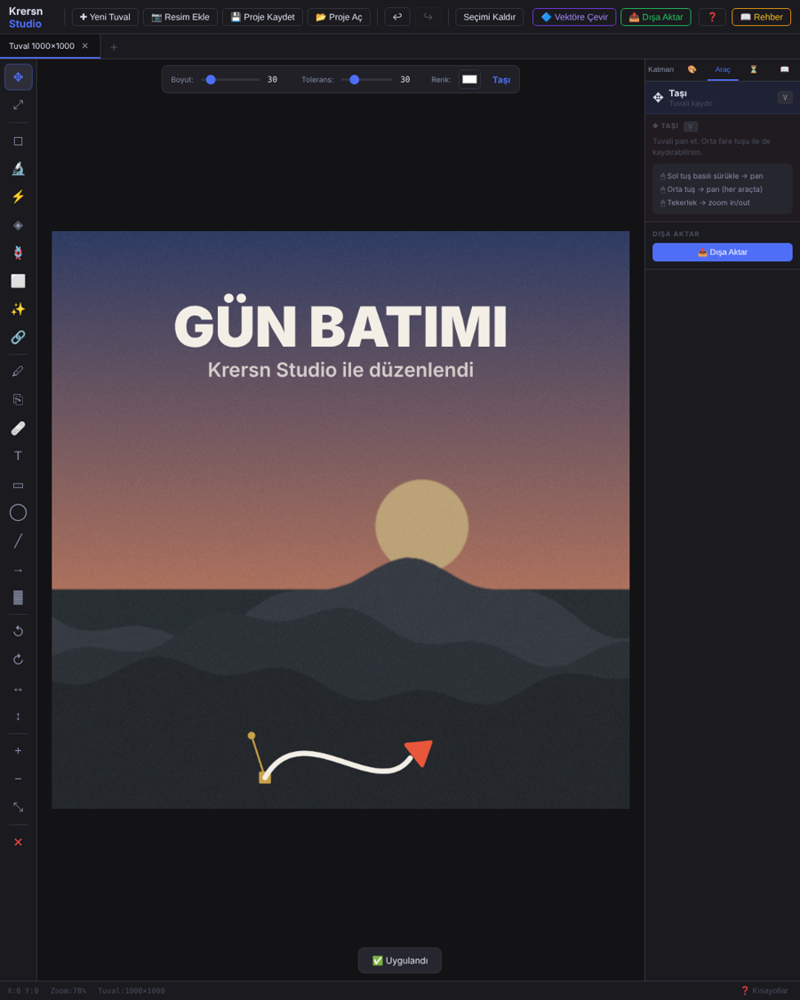
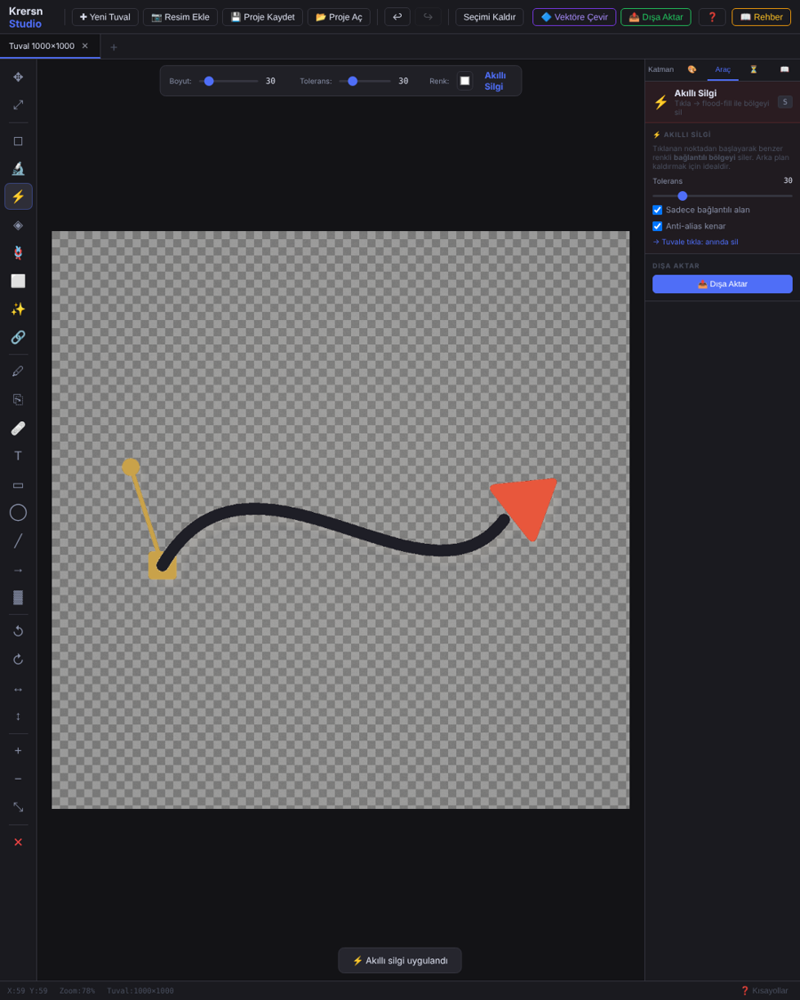
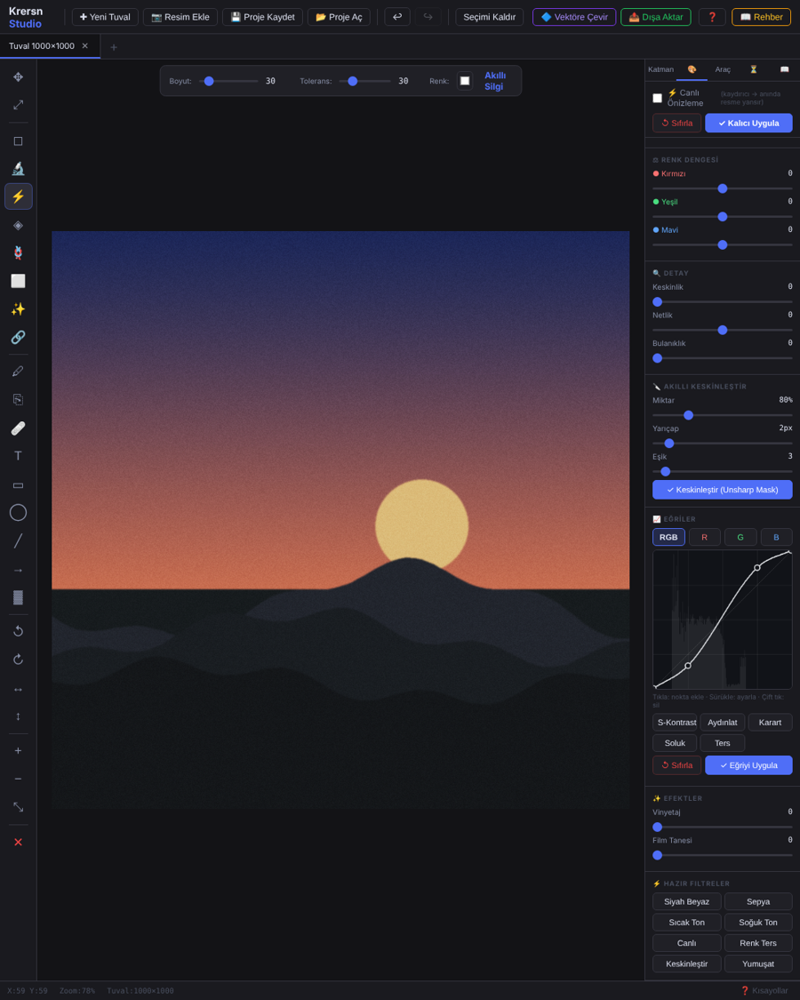
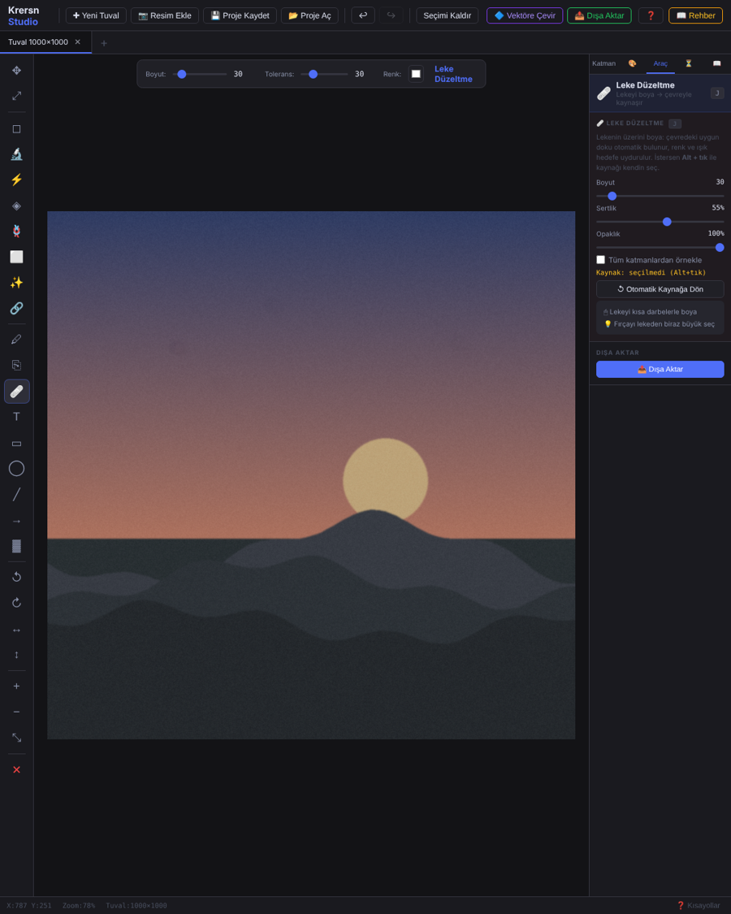

# Krersn Studio Editör

**Tarayıcıda çalışan, açık kaynak fotoğraf düzenleyici.** Kurulum yok, sunucu yok: linke tıkla ve kullan. Telefonda ve bilgisayarda çalışır, ana ekrana uygulama olarak eklenebilir.

🔗 **Hemen dene:** https://krersnstudio.com/krersn-studio-editor/

## Özellikler

- **Katmanlar:** opaklık, karışım modları, katman gölgesi, kilit, birleştir ve düzleştir
- **Silgiler:** fırça silgi, akıllı silgi (tek tıkla arka plan), renk yakala + sil, global renk silgi, lasso ve dikdörtgen silgi
- **Seçim:** sihirli değnek, lasso seçim (ekle/çıkar); fırça ve silgi seçimin içinde kalır
- **Kırp:** serbest veya sabit oran (1:1, 16:9, 9:16, 4:3, 3:2, A4)
- **Çizim:** fırça, metin, dikdörtgen, elips, çizgi, ok, gradyan
- **Rötuş:** klon damgası (Alt+tık ile kaynak seç), leke düzeltme (otomatik kaynak + renk uyumu)
- **Renk:** ışık, renk, renk dengesi, detay ve efekt ayarları; **eğriler** (RGB/R/G/B), akıllı keskinleştirme (Unsharp Mask), hazır filtreler
- **Proje:** katmanlarıyla `.krersn` olarak kaydet ve aç, çoklu sekme, geri al geçmişi
- **Dışa aktarma:** PNG, JPG, WebP, PNG-8; boyut ve kalite ayarı, istediğin dosya adı
- **Vektöre çevir (SVG):** logo ve düz renkli grafikleri kapalı konturlu, delikleri korunan SVG'ye çevirir
- **Görsel yerleştirme:** tek tuşla Sığdır (F) veya Doldur (Shift+F), oran bozulmaz; **döndürme** (kol ile veya ±90°, Shift = 15° adım), **yuvarlak köşe**; Geri ve İptal butonları
- **Mobil uyum:** dokunmatik çizim, iki parmakla yakınlaştır/kaydır, açılır panel, dikey ekrana göre yerleşim
- **Uygulama olarak yükle (PWA):** 📲 Yükle ile ana ekrana ekle; internetsiz de açılır
- **Otomatik kayıt:** çalışman tarayıcıya kaydedilir; sayfa kapanırsa açılışta geri yükleme sorar
- **Hazır şablonlar:** Shorts/Reels/TikTok 1080×1920, YouTube kapak, Play öne çıkan 1024×500, Play ikon 512×512, Play ekran görüntüleri
- **▦ Güvenli alan kılavuzu:** Shorts arayüz bölgeleri, Play öne çıkan görsel ve ikon maskesi (dışa aktarmaya dahil olmaz)
- **⭐ Logo / filigran:** logonu bir kez seç, tek dokunuşla köşeye veya ortaya yerleştir
- **Pano:** Ctrl+C / Ctrl+X / Ctrl+V (ekran görüntüsü de yapıştırabilirsin)

| Akıllı silgi | Eğriler | Leke düzeltme |
|---|---|---|
|  |  |  |

## Kullanım

1. **[Editörü aç](https://krersnstudio.com/krersn-studio-editor/)** — Chrome, Edge, Firefox veya Safari (telefon dahil).
2. **✚ Yeni Tuval** ile başla ya da bir resmi sürükleyip bırak.
3. İstersen 📲 **Yükle** ile uygulama olarak ekle.

Çevrimdışı kullanmak için `index.html` dosyasını indirip doğrudan da açabilirsin (bu durumda PWA ve otomatik kayıt tarayıcıya göre sınırlı olabilir).

`F1` tuşu tüm kısayolları gösterir.

## Kısayollar (özet)

| İşlem | Kısayol |
|---|---|
| Geri al / İleri al | Ctrl+Z / Ctrl+Y |
| Dışa aktar | Ctrl+S |
| Proje kaydet / aç | Ctrl+Shift+S / Ctrl+Shift+O |
| Kopyala / Kes / Yapıştır | Ctrl+C / Ctrl+X / Ctrl+V |
| Fırça / Silgi / Akıllı silgi | P / E / S |
| Klon damgası / Leke düzeltme | U / J |
| Kırp | C (Enter: uygula) |

## Bilinen eksikler

- **Vektöre Çevir (SVG)** logo ve düz grafiklerde iyi sonuç verir; fotoğraflarda sonuç posterize (bantlı) görünür.
- Telefonda klavye kısayolları yok; aynı işler butonlarla yapılır (klon kaynağı için **🎯 Kaynak Seç**).
- Otomatik kayıt tarayıcının kendi depolamasındadır; tarayıcı verilerini silersen gider. Önemli işleri `.krersn` proje dosyası olarak da kaydet.
- Güvenli alan kılavuzları yaklaşıktır; platformların arayüzü zamanla değişebilir.

## Katkı

Hata bildirimi ve önerileri **Issues** sekmesinden açabilirsin. Değişiklik yapmak istersen depoyu fork'la ve Pull Request gönder.

## Lisans

[MIT](LICENSE) © 2026 Krersn Studio. Kodu özgürce kullanabilir, değiştirebilir ve paylaşabilirsin; telif notunu koruman yeterli.

---

*Bu editör, yapay zekâ ile birlikte adım adım geliştirildi.* · [krersnstudio.com](https://krersnstudio.com)

---

## English

**Krersn Studio Editor** is a free, open-source photo editor in a single HTML file: no install, runs entirely in your browser. It has layers, smart eraser, curves, unsharp mask, clone stamp, spot healing, image rotation, `.krersn` project files and PNG/JPG/WebP export. Works on phones (touch drawing, pinch zoom), installs as a PWA, autosaves to the browser and ships Shorts / Google Play templates with safe-area guides. Try it: https://krersnstudio.com/krersn-studio-editor/ Licensed under MIT.
